

  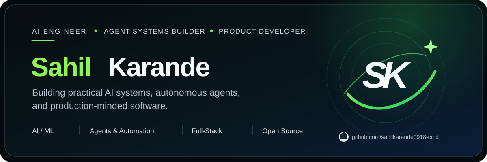
   
  
  
  
    
  <strong>AI systems · Autonomous agents · Machine learning · Full-stack products</strong>

## What I build

I’m **Sahil Karande**, a computer science (AI &amp; ML) student who builds **agent-based tools and real software products**—from security testing and assistive technology to AI-assisted editing and predictive systems. I care about reliable engineering: reproducible outcomes, clear system boundaries, meaningful testing and usable products.

**Currently exploring:** agent orchestration, MCP, trustworthy AI, developer tooling and product engineering.

## Featured work

<table><tr>
<td width="50%"><a href="https://github.com/sahilkarande0918-cmd/Agent-Fleet">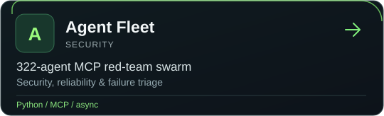</a></td>
<td width="50%"><a href="https://github.com/sahilkarande0918-cmd/Veris">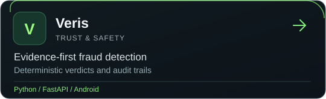</a></td>
</tr><tr>
<td><a href="https://github.com/sahilkarande0918-cmd/Kisan-Raksha-project">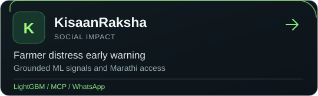</a></td>
<td><a href="https://github.com/sahilkarande0918-cmd/Drishti-2.0-app">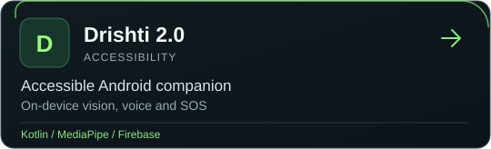</a></td>
</tr><tr>
<td><a href="https://github.com/sahilkarande0918-cmd/Reel-Studio">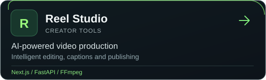</a></td>
<td><a href="https://github.com/sahilkarande0918-cmd/AeroPulse-AI">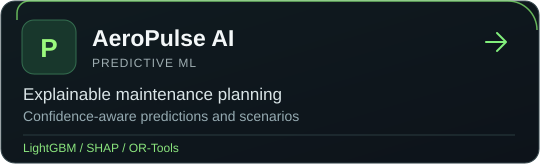</a></td>
</tr></table>

## Technology stack

 

## GitHub at a glance

<!-- Live GitHub statistics. These are generated from GitHub data every day; never hand-entered. -->

  

### Languages & technologies

  

### The contribution landscape

  

## Contributions, in motion

<!-- Self-hosted, animated SVGs generated from the GitHub contributions API every day. -->

  <picture>
    <source media="(max-width: 767px)" srcset="./activity-graph-mobile.svg" />
    
  </picture>

### Lifetime contribution history

  

  
<strong>Explore more: coding rhythm, trends and the snake</strong>

   
  

    
      
    
      
    <picture>
      <source media="(prefers-color-scheme: dark)" srcset="https://raw.githubusercontent.com/sahilkarande0918-cmd/sahilkarande0918-cmd/output/github-snake-dark.svg" />
      
    </picture>
  

<a href="https://github.com/sahilkarande0918-cmd?tab=repositories">Explore all repositories</a> · <a href="https://linkedin.com/in/sahil-karande-a4722b386">Connect on LinkedIn</a>

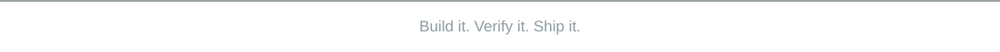

